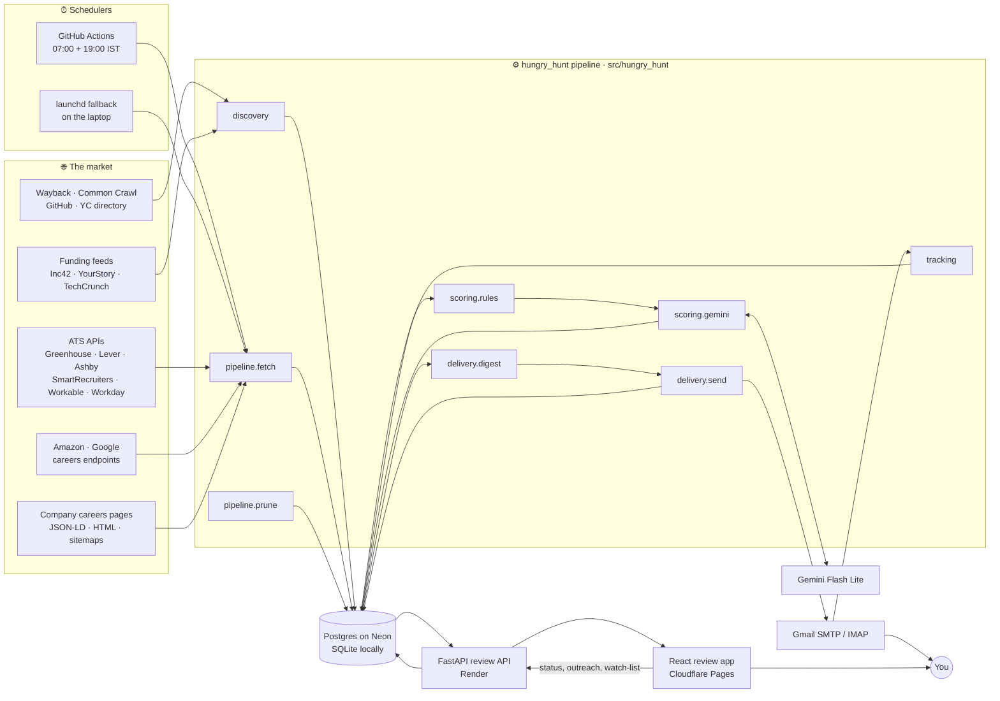
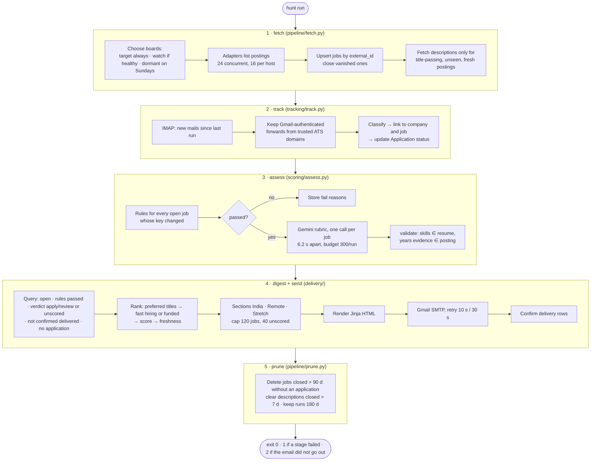
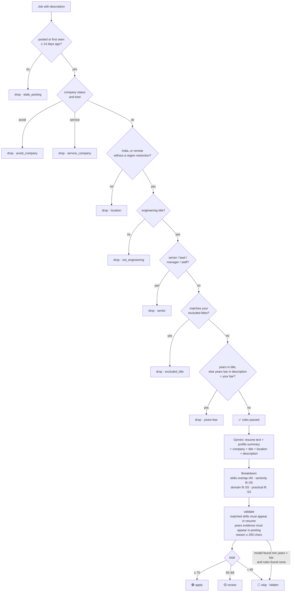
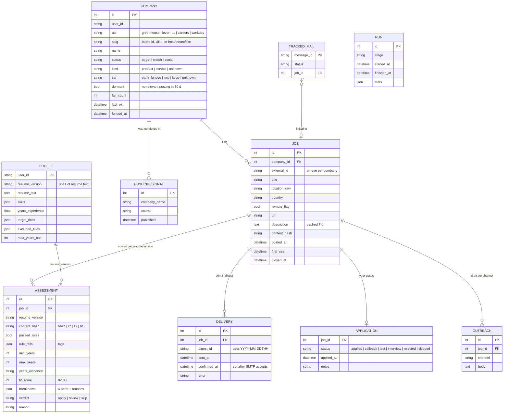
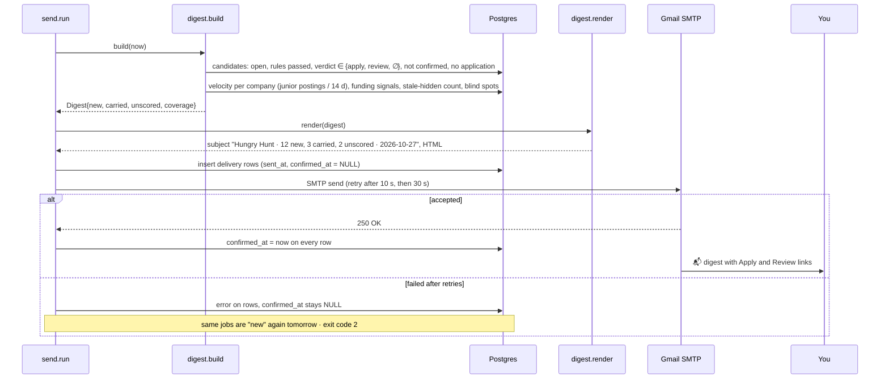
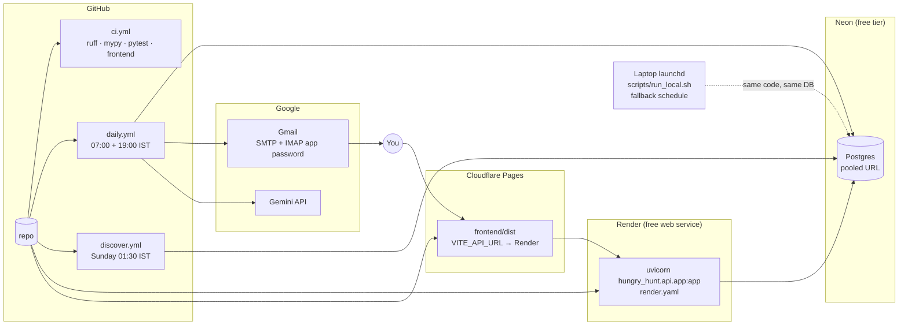
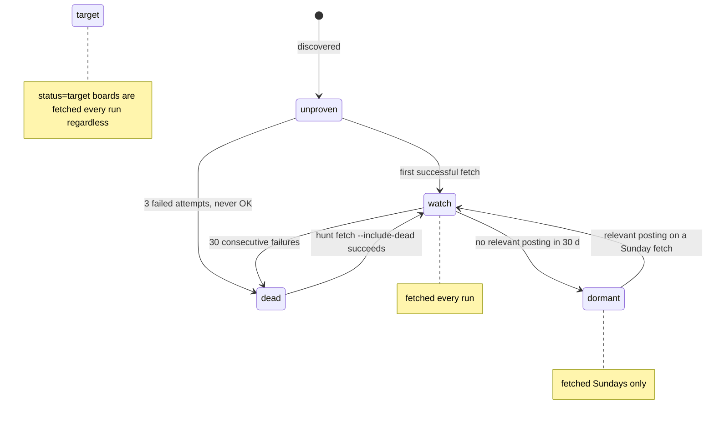

<div align="center">

# 🎯 Hungry Hunt

**A job-search agent that reads company hiring systems directly, drops what does not fit an early-career engineer, scores the rest against your actual resume, and emails you one honest digest a day.**

[](https://github.com/Poojitha319/hungry_hunt/actions/workflows/ci.yml)
[](https://www.python.org/)
[](https://fastapi.tiangolo.com/)
[](https://www.sqlalchemy.org/)
[](https://neon.tech/)
[](https://react.dev/)
[](https://ai.google.dev/)
[](https://docs.astral.sh/ruff/)
[](https://mypy-lang.org/)
[](LICENSE)

<br/>

> *From unemployed scrolling to employed shipping.*
> *It finds and decides. You apply.*

</div>

---

## 📚 Table of Contents

- [Why This Exists](#-why-this-exists)
- [What It Does](#-what-it-does)
- [Architecture](#-architecture)
  - [System Overview](#system-overview)
  - [One Daily Run](#one-daily-run)
  - [How a Job Gets Decided](#how-a-job-gets-decided)
  - [Data Model](#data-model)
  - [Anatomy of a Digest Email](#anatomy-of-a-digest-email)
  - [Deployment](#deployment)
- [The Layers](#-the-layers)
  - [1. Discovery](#1-discovery)
  - [2. Adapters](#2-adapters)
  - [3. Pipeline](#3-pipeline)
  - [4. Scoring](#4-scoring)
  - [5. Delivery](#5-delivery)
  - [6. Tracking](#6-tracking)
  - [7. Review API](#7-review-api)
  - [8. Frontend](#8-frontend)
  - [9. Storage and Migrations](#9-storage-and-migrations)
  - [10. CLI and Scheduling](#10-cli-and-scheduling)
  - [11. Core: HTTP, Schemas, Logging](#11-core-http-schemas-logging)
- [Hiring Systems](#-hiring-systems)
- [Project Structure](#-project-structure)
- [Getting Started](#-getting-started)
- [Configuration](#-configuration)
- [Running It](#-running-it)
- [Deploying It](#-deploying-it)
- [Testing and Quality](#-testing-and-quality)
- [Design Decisions](#-design-decisions)
- [Known Limitations](#-known-limitations)
- [Roadmap](#-roadmap)
- [License](#-license)

---

## 🎯 Why This Exists

Job boards are built for recruiters. A fresher in India with no referrals gets the worst of them: aggregator
listings that closed weeks ago, "SDE I" postings that quietly require three years, agency reposts, and a hundred
tabs a day to find the four roles that are real.

Every company that hires at scale runs an applicant tracking system, and most of those systems expose the live
list of openings as JSON or structured HTML. Hungry Hunt reads those sources directly. A job is in your digest only
if it is **posted on the company's own hiring system**, **still live**, **in India or genuinely remote**, and the
**experience bar stated in the title or, failing that, read from the description** is one you can meet.

It never applies for you, never messages anyone, and never invents a fact about you. It finds and decides; you
apply and reach out. Your time goes to interview prep instead of scrolling.

---

## ✨ What It Does

| Capability | How it works |
|---|---|
| 🔭 **Market-wide discovery** | Seeds, the Wayback Machine, Common Crawl, GitHub lists, the YC directory, funding feeds and a headless sniffer turn company names into ATS board slugs. Today: ~9,100 companies watched. |
| 🧩 **Nine hiring-system adapters** | Greenhouse, Lever, Ashby, SmartRecruiters, Workable, Workday, Amazon, Google, and JSON-LD/plain-HTML careers pages, each reading the system's own API. |
| 🚦 **Deterministic drop rules** | Location, engineering title, seniority, excluded titles, service companies, posting age, and the years bar are pure functions with table-driven tests. Every drop carries a reason tag. |
| 🧠 **Resume-grounded scoring** | Gemini scores survivors on a four-part rubric (skills 40, seniority 25, domain 20, practical 15). Claimed skills are checked against your resume text; cited years must appear verbatim in the posting. |
| 📬 **One digest, no repeats** | A job is "delivered" only after SMTP accepts the email. Anything else rolls into tomorrow. The footer says what the pipeline could not see. |
| ⏱ **Adaptive fetch cadence** | Target boards every run; boards with no relevant posting in 30 days drop to Sundays; dead boards stop. Descriptions are cached for a week. |
| 📈 **Signals that beat score** | Junior titles and your preferred roles rank first, then companies hiring fast (3+ junior postings in 14 days) or recently funded, then score, then freshness. |
| 📮 **Application tracking** | Forward a hiring email to your digest mailbox and the tracker reads it over IMAP, classifies it (applied, test, interview, rejected) and links it to the job. Status never downgrades. |
| ✍️ **Grounded outreach drafts** | One-click LinkedIn or email drafts for a job, validated so every skill and claim traces back to your resume. |
| 🖥 **Review app** | Today's digest, job detail with the rule and score breakdown, status changes, outreach, company watch-list, and coverage history. |
| 🔐 **Hardened by default** | SSRF-guarded outbound HTTP, manual redirects, size caps, ReDoS-safe regexes, constant-time token checks, no secrets in the repository. |

---

## 🏗 Architecture

### System Overview



Three principles hold the whole thing together:

1. **Every drop is a pure function with a reason.** `scoring/rules.py` has no I/O. A job that is not in your digest
   has a tag (`location`, `senior`, `years>bar`, `stale_posting`, …) stored on its assessment, visible in the app.
2. **Delivery is a ledger, not a log.** `send` writes a `delivery` row per job and confirms it only after SMTP
   accepts the message. The next digest excludes confirmed jobs and carries over the rest.
3. **Re-evaluation is keyed, not scheduled.** An assessment is cached under
   `content_hash | rules version | scoring version | years bar`. Change any of them and only the affected jobs are
   redone on the next run.

### One Daily Run



Each stage is isolated. A fetch failure does not stop assessment; an assessment failure does not stop the email.
The exit code tells the scheduler what happened, and every stage writes a `run` row with its stats.

### How a Job Gets Decided



The rules run on every job, every time their inputs change, with no model call. Gemini is spent only on jobs that
already passed, and its output is checked against the two documents it was given before anything is stored.

### Data Model



### Anatomy of a Digest Email



The digest has three sections, **India**, **Remote**, and **Stretch** (up to 20 roles slightly above your bar),
each split into *new* and *carried* (sent before but not yet confirmed or acted on). Each row shows company, tier,
title, location, age, score with the four-part breakdown, the model's one-line reason, a direct **Apply** link to the
company's own posting and a **Review** link into the app. The footer reports what the pipeline could not see: boards
that failed, ATSes it cannot read, target boards gone stale, jobs hidden as too old, Gemini quota hits, and
recently funded companies that are not yet watched.

### Deployment



Secrets live in GitHub Actions secrets, Render environment variables and your local `.env`. Nothing in the
repository or its history contains a credential; `SECURITY.md` has the details.

---

## 🧱 The Layers

Each subsection answers the same three questions: what it does, where it lives, how to extend it.

### 1. Discovery

**What.** Turns the open market into a watch-list of `(ats, slug)` boards. Sources, selectable per run with
`hunt discover --sources ...`:

| Source | What it reads | What it yields |
|---|---|---|
| `seeds` | `discovery/seeds.py`: 59 hand-verified boards | target boards that are always fetched |
| `wayback` | Wayback CDX index for `boards.greenhouse.io`, `jobs.lever.co`, `jobs.ashbyhq.com`, … | every slug those hosts ever served |
| `cc` | Common Crawl index, five recent crawls | the same, for the long tail |
| `github` | curated "companies hiring in India" lists | names and board URLs |
| `yc` | the public YC directory | India-linked companies, probed at `/careers`, `/jobs`, `/` |
| `careers` | a company's own site | JSON-LD `JobPosting` pages, linked job pages, sitemap job URLs |
| `funding` | Inc42, YourStory, TechCrunch venture feeds | `funding_signal` rows, `funded_at` on matched companies |
| `sniff` | headless Chromium (optional `[sniff]` extra) | the ATS behind JavaScript-only careers pages, from frames, XHR bodies and request URLs |

Companies are classified on the way in: `kind` (product, service via title and name heuristics, unknown) and
`tier` (early_funded, mid, large) from team size and posting count. Unsupported systems (Eightfold, Phenom, Oracle
HCM, …) are stored as **blind spots** and listed in the digest footer so you know what you are not seeing.

**Where.** `src/hungry_hunt/discovery/`: `discover.py` (sources and upserts), `seeds.py`, `funding.py`,
`sitemaps.py`, `sniff.py`.

**Extend.** Add a URL pattern to `URL_PATTERNS` so `boards_from_text` recognises a new ATS; add a source branch in
`discover()`.

### 2. Adapters

**What.** One module per hiring system that turns the system's API into a list of `Posting` objects (external id,
title, location, country, remote flag, URL, posted date, description when the list call includes it). Three
shapes:

- **Single JSON endpoint** (Greenhouse, Lever, Ashby): `HOSTS` with EU fallback, `PARAMS`, `parse(data)`.
- **Paged** (SmartRecruiters, Workable feed, Workday CXS, Amazon, Google): `async board(client, slug, limits)`.
- **Careers page** (`careers.py`): JSON-LD blocks, then linked job pages, then the sitemap; a plain-HTML reader in
  `html.py` extracts a posting from an `<h1>` plus hiring cues when there is no structured data.

`registry.py` is the only thing the pipeline imports: `SUPPORTED`, `board_url()`, `list_jobs()` and `AtsSource`,
which also fetches per-job descriptions for the systems that need a second call (Greenhouse, SmartRecruiters,
Workday).

**Where.** `src/hungry_hunt/adapters/`.

**Extend.** See [CONTRIBUTING.md](CONTRIBUTING.md#adding-a-hiring-system): one module, one registry entry, one
fixture, one test.

### 3. Pipeline

**What.** `fetch.py` chooses boards by health and cadence, lists them concurrently through the adapters, upserts
jobs by `(company, external_id)`, closes jobs that vanished, and fetches descriptions only for title-passing,
unseen, fresh postings. Board state machine:



`run.py` holds the daily orchestration (`run_daily`) with one try/except per stage and a `RunSummary` whose
`exit_code` the CLI returns. `prune.py` keeps the database small.

**Where.** `src/hungry_hunt/pipeline/`.

### 4. Scoring

**What.** Two gates in order.

**Rules** (`rules.py`, `RULES_VERSION = 7`) are pure functions: `location()` classifies India / remote / restricted
regions from the raw location string and description; `title_kind()` says engineering-or-not and senior-or-not;
`years_in_title()` then `years_bar()` read the experience bar; `company_kind()` flags consultancies; `evaluate()`
combines them into a `RuleResult` with tags. The regexes are ReDoS-safe and every branch has a table-driven test.

**Gemini** (`gemini.py`, `assess.py`, `SCORING_VERSION = 2`) sees your resume text, a profile summary, the company,
title, location and description, and must return strict JSON matching `AssessmentOut`: matched and missing skills,
min/max years with a verbatim `years_evidence` quote, and a `Breakdown` of four scores. `validate()` then removes
any matched skill not found in your resume, drops years evidence not found in the posting, recomputes the total
in code and sets the verdict at 70 / 45. Calls are spaced 6.2 s apart with a per-run budget, and a quota error ends
the stage cleanly with `quota_hit` in the footer instead of a crash.

`profile.py` builds your profile once per resume version (sha1 of the LaTeX text): skills, years, summary, plus
preferred and excluded titles you set with `hunt profile --targets ... --exclude ...`.

**Where.** `src/hungry_hunt/scoring/`.

**Extend.** New rule → add a tag in `evaluate()`, a row in `tests/scoring/test_rules.py`, bump `RULES_VERSION`.
New rubric → change the prompt and `Breakdown`, bump `SCORING_VERSION`. Both bumps re-score every open job once.

### 5. Delivery

**What.** `digest.py` queries candidates, ranks them, splits new from carried, applies caps and builds the
coverage footer; `render()` fills `templates/digest.html.j2`. `send.py` writes delivery rows, sends over Gmail
SMTP with two retries, and confirms the rows only on success. `outreach.py` drafts a LinkedIn or email message
for one job and validates that every proper noun, number and skill in the draft traces back to your resume or the
posting.

**Where.** `src/hungry_hunt/delivery/`.

### 6. Tracking

**What.** Forward a hiring email to the digest mailbox (or set a Gmail filter to do it). `track.py` reads new
mail over IMAP (headers plus the first 2 KB), keeps only Gmail-authenticated forwards from trusted ATS and company
domains, classifies the event (applied, test, interview, rejected) from subject and snippet, matches the company
by name and the job by title, and writes an `application` row. Status moves forward only; a rejection after an
interview does not become "applied" again.

**Where.** `src/hungry_hunt/tracking/track.py`.

### 7. Review API

**What.** FastAPI app behind a single bearer token (constant-time compare), CORS limited to the review app
origin. Routes:

| Method | Path | Purpose |
|---|---|---|
| GET | `/health` | liveness, proves the DB answers |
| GET | `/api/digest?days=` | today's digest, uncapped, same ranking as the email |
| GET | `/api/jobs/{id}` | job, company, assessment with breakdown, your application |
| POST | `/api/jobs/{id}/status` | set applied / callback / test / interview / rejected / skipped |
| GET, POST | `/api/jobs/{id}/outreach` | load or draft outreach |
| GET, POST | `/api/companies` | watch-list with filters; add a board from `ats:slug` or a URL |
| POST | `/api/companies/{id}` | change status or notes |
| GET | `/api/coverage?days=` | pipeline run history |

`create_app(settings, sf, now, llm)` is an injectable factory; tests run it in-process with SQLite and fakes.

**Where.** `src/hungry_hunt/api/`: `app.py` (factory), `deps.py` (context, session, auth, ownership), `schemas.py`,
`routes/`.

### 8. Frontend

**What.** Vite, React 19, TypeScript, TanStack Query, with a client generated from the API's OpenAPI schema
(`frontend/openapi.json`, regenerate with `make openapi`). Screens: digest, job detail with status form and
outreach panel, companies with an add box and filters, coverage. The token arrives once in the digest link, is
stored in `localStorage`, and is removed from the URL.

**Where.** `frontend/`; see [frontend/README.md](frontend/README.md).

### 9. Storage and Migrations

**What.** SQLAlchemy 2 models in `db/models.py`, a `TZDateTime` type that keeps every datetime UTC-aware on both
SQLite and Postgres, and `make_engine()` which pre-pings and recycles pooled connections every five minutes so
long runs survive Neon's idle disconnects. Nine Alembic migrations in `migrations/`. `db/copydb.py` copies a whole
database between URLs (how the local SQLite history moved to Neon).

**Where.** `src/hungry_hunt/db/`, `migrations/`, `alembic.ini`.

### 10. CLI and Scheduling

**What.** `hunt` (also `python -m hungry_hunt`): `profile`, `discover`, `fetch`, `assess`, `digest --preview`,
`send`, `track`, `prune`, `run`. `cli/parser.py` defines the arguments, `cli/commands.py` has one function per
command, `main()` wires settings, the engine and the `Pipeline` of injected dependencies (source, LLM, mailer,
mailbox, clock) so the whole CLI is testable without the network.

Schedules: `.github/workflows/daily.yml` runs `hunt run` at 07:00 and 19:00 IST; `discover.yml` runs the full
discovery on Sunday nights; `scripts/run_local.sh` plus the launchd plist example run the same thing from a
laptop when Actions is not configured.

**Where.** `src/hungry_hunt/cli/`, `.github/workflows/`, `scripts/`.

### 11. Core: HTTP, Schemas, Logging

**What.** `core/http.py` is the only way out to the internet: `safe_url()` resolves the host and refuses anything
that is not a global address (no loopback, private ranges, link-local, `.local`), redirects are followed by hand
through the same check, bodies are size-capped, and `Limits` holds a global and a per-host semaphore. `core/schemas.py`
has the Pydantic models passed between stages; `core/ports.py` the `JobSource`, `Assessor` and `Mailer` protocols
that fakes implement in tests. `log.py` configures one root handler, plain text for a terminal or JSON lines
(`LOG_FORMAT=json`) for Actions and Render.

**Where.** `src/hungry_hunt/core/`, `src/hungry_hunt/log.py`, `src/hungry_hunt/config.py`.

---

## 🧩 Hiring Systems

| System | Slug form | Discovered by | Listing | Description | Status |
|---|---|---|---|---|---|
| Greenhouse | `greenhouse:<board>` | wayback, cc, github, sniff | boards API (US, EU fallback) | per-job call, cached 7 d | ✅ |
| Lever | `lever:<company>` | wayback, cc, github, sniff | postings API | in listing | ✅ |
| Ashby | `ashby:<company>` | wayback, cc, sniff | job-board API | in listing | ✅ |
| SmartRecruiters | `smartrecruiters:<company>` | sniff, add by URL | public postings API, paged | per-job call | ✅ |
| Workable | `workable_feed:India` → `workable:<id>` members | feed | jobs.workable.com India feed | in listing | ✅ feed only; direct polling is rate-banned |
| Workday | `workday:<host>/<tenant>/<site>` | sniff, add by URL | CXS jobs API, paged | per-job call | ✅ |
| Amazon | `amazon:IND` | seed | search JSON | in listing | ✅ |
| Google | `google:India` | seed | results page data records | in listing | ✅ |
| Careers page | `careers:<url>` | yc, careers, sniff | JSON-LD → linked pages → sitemap → HTML | in page | ✅ when the page is server-rendered |
| Eightfold, Phenom, Oracle HCM, Darwinbox, Keka | — | recognised, stored as blind spots | — | — | ❌ listed in the footer |

Pages that render only in JavaScript (some fintechs) are found by the weekly sniffer, which usually reveals an ATS
behind them (PhonePe and Swiggy turned out to be SmartRecruiters). What stays blind is reported, never silently
skipped.

---

## 📁 Project Structure

```
hungry_hunt/
├── src/hungry_hunt/
│   ├── cli/            parser.py · commands.py · main()
│   ├── core/           http.py (SSRF guard, limits) · schemas.py · ports.py
│   ├── db/             engine.py · models.py · copydb.py
│   ├── adapters/       greenhouse · lever · ashby · smartrecruiters · workable · workday · amazon · google · careers · html · registry
│   ├── discovery/      discover.py · seeds.py · funding.py · sitemaps.py · sniff.py
│   ├── pipeline/       fetch.py · prune.py · run.py
│   ├── scoring/        rules.py · gemini.py · assess.py · profile.py
│   ├── delivery/       digest.py · send.py · outreach.py · templates/digest.html.j2
│   ├── tracking/       track.py
│   ├── api/            app.py · deps.py · schemas.py · routes/{health,digest,jobs,outreach,companies,coverage}.py
│   ├── config.py       Settings (pydantic-settings)
│   └── log.py          configure_logging()
├── frontend/           Vite + React review app
├── migrations/         Alembic
├── tests/              mirrors src/ · fixtures/ captured from real APIs
├── scripts/            run_local.sh · launchd plist example
├── data/slugs.json     8.7k boards harvested from Common Crawl (optional one-off import)
├── docs/               PRD.md · ARCHITECTURE.md · superpowers/ (design and plan records)
├── .github/workflows/  ci.yml · daily.yml · discover.yml
├── Dockerfile · Makefile · pyproject.toml · uv.lock · alembic.ini · render.yaml · .pre-commit-config.yaml
└── README.md · CONTRIBUTING.md · SECURITY.md · CHANGELOG.md · LICENSE
```

---

## 🚀 Getting Started

Requirements: Python 3.12, Node 22 (for the review app), and optionally [uv](https://docs.astral.sh/uv/).

```bash
git clone https://github.com/Poojitha319/hungry_hunt && cd hungry_hunt
make install                     # uv sync --extra dev, or a pip venv if uv is absent; installs the pre-commit hook
cp .env.example .env             # fill GEMINI_API_KEY, SMTP_USER, SMTP_PASSWORD, DIGEST_TO, REVIEW_TOKEN
make migrate                     # creates hunt.db (SQLite) at migration head
```

Without uv:

```bash
python3.12 -m venv .venv && . .venv/bin/activate && pip install -e ".[dev]"
```

Put your resume as LaTeX at the path in `RESUME_TEX` (default `./resume.tex`). The profile is extracted locally,
never in CI, and the resume text never leaves your database except inside Gemini scoring calls.

---

## ⚙️ Configuration

Every setting is an environment variable or a line in `.env` (`src/hungry_hunt/config.py`).

| Variable | Default | Meaning |
|---|---|---|
| `DATABASE_URL` | `sqlite:///hunt.db` | SQLAlchemy URL; `postgresql://` is upgraded to the psycopg driver |
| `USER_ID` | `poojitha` | key for your rows; one database can hold several users |
| `GEMINI_API_KEY` | | Google AI Studio key |
| `GEMINI_MODEL` | `gemini-3.5-flash-lite` | any model with a usable free quota |
| `ASSESS_MAX_CALLS` | `300` | Gemini calls per run |
| `ASSESS_INTERVAL_S` | `6.2` | seconds between calls (free-tier rate) |
| `SMTP_USER`, `SMTP_PASSWORD` | | Gmail address and app password; also used for IMAP tracking |
| `DIGEST_TO` | | where the digest goes |
| `REVIEW_BASE_URL` | `http://localhost:5173` | the review app origin (CORS and email links) |
| `REVIEW_TOKEN` | | shared bearer token for the API |
| `DIGEST_MAX_JOBS` | `120` | cap per email |
| `FETCH_CONCURRENCY`, `FETCH_PER_HOST` | `24`, `16` | outbound limits |
| `REMOTE_OK` | `true` | include unrestricted remote roles |
| `MAX_YEARS_BAR` | `2` | drop postings whose minimum experience exceeds this |
| `MAX_POSTED_AGE_DAYS` | `14` | drop postings older than this |
| `RESUME_TEX` | `./resume.tex` | your resume source |
| `TRACK_DAYS`, `TRACK_REQUIRE_FORWARDED` | `14`, `true` | tracker lookback; require Gmail forward headers |
| `LOG_LEVEL`, `LOG_FORMAT` | `INFO`, `plain` | `json` for log collectors |

---

## 🏃 Running It

```bash
hunt profile --targets "backend,python,SDE,AI engineer,LLM" --exclude "Android,iOS"   # once per resume change
hunt discover --seeds                                   # the verified boards
hunt discover --slugs data/slugs.json                   # optional: 8.7k harvested boards
hunt discover --sources funding,wayback,cc,github,yc,careers   # the weekly discovery (minutes to an hour)
hunt fetch --only lever:hevodata,greenhouse:observeai   # or just `hunt fetch`
hunt assess --max-calls 20
hunt digest --preview digest.html && open digest.html   # look before you send
hunt send                                               # or the whole thing: hunt run
```

Review app:

```bash
make api                                   # http://localhost:8000, docs at /docs
cd frontend && npm ci && npm run gen && VITE_API_URL=http://localhost:8000 npm run dev
```

Docker (API image):

```bash
make docker && docker run --rm -p 8000:8000 --env-file .env hungry-hunt
docker run --rm --env-file .env hungry-hunt hunt run      # the pipeline in the same image
```

The image is meant for Postgres (`DATABASE_URL=postgresql://...`). With the SQLite default the database file is
created inside the container and vanishes with it.

---

## ☁️ Deploying It

1. **Database.** Create a Neon project and copy the pooled connection string into `DATABASE_URL`. Run
   `alembic upgrade head` once from your machine, then `python -m hungry_hunt.db.copydb sqlite:///hunt.db "$DATABASE_URL"`
   if you have local history to keep.
2. **GitHub Actions.** Secrets: `DATABASE_URL`, `GEMINI_API_KEY`, `SMTP_USER`, `SMTP_PASSWORD`, `DIGEST_TO`,
   `REVIEW_TOKEN`. Variables: `GEMINI_MODEL`, `USER_ID`, `REVIEW_BASE_URL`. Enable `daily` and `discover`, trigger
   `daily` once by hand and check the run log and the digest artifact. GitHub pauses scheduled workflows on public
   repositories after 60 days without a commit; a separate `keepalive` job in `daily.yml` re-enables the schedule through the
   API so the digest keeps coming.
3. **API on Render.** `render.yaml` is a blueprint: connect the repo, set the same secrets, the health check is
   `/health`.
4. **Review app on Cloudflare Pages.** Root directory `frontend`, build `npm ci && npm run build`, output `dist`,
   environment `VITE_API_URL` = the Render URL. Set `REVIEW_BASE_URL` to the Pages URL so email links and CORS
   match.
5. **Laptop fallback.** Copy `scripts/com.hungryhunt.daily.plist.example` to `~/Library/LaunchAgents/`, fix the
   paths, `launchctl bootstrap gui/$UID <plist>`. It runs the same `hunt run` against the same database; turn it
   off once Actions is green.

---

## 🧪 Testing and Quality

```bash
make check            # ruff check · ruff format --check · mypy · pytest (437 tests, ~7 s, no network)
cd frontend && npm run lint && npm run typecheck && npm test && npm run build
pre-commit run --all-files
```

- Tests mirror the package: `tests/adapters`, `tests/scoring`, … Fixtures in `tests/fixtures/` are real API
  responses. The autouse `public_dns` fixture pins DNS so the SSRF guard passes without resolving anything, and
  `respx` mocks HTTP.
- To run the suite against Postgres: `HUNT_TEST_DATABASE_URL=postgresql://... pytest`.
- CI (`.github/workflows/ci.yml`) runs the Python and frontend checks on every push and pull request with uv and a
  frozen lockfile.

---

## 🧭 Design Decisions

| Decision | Why |
|---|---|
| **Own adapters instead of a scraping library** | The goal is genuine applications across the whole market, not a fixed company set. Each ATS has a stable public API; reading it directly is more reliable than HTML scraping and lets discovery be market-wide. |
| **Rules before the model** | Deterministic rules are free, fast, auditable and testable. Gemini sees only jobs that already pass, which keeps the free-tier budget for the decisions that need judgement. |
| **Validation of model output in code** | The model is asked for evidence (quoted years, named skills) and the code checks the evidence exists. Scores are summed in code, not trusted from the model. |
| **Delivery as a ledger** | "I emailed it" is a fact about SMTP, not about building the HTML. Confirming after acceptance means a failed send does not lose jobs. |
| **Keyed re-evaluation** | Bumping a version constant re-scores exactly the jobs it affects, with no manual cache clearing and no full re-run. |
| **No auto-apply, no auto-message** | Applications and outreach are yours. The agent drafts and grounds; it never sends on your behalf. |
| **Adaptive cadence and a 14-day age cap** | 7,000 boards a day is wasteful when most have no junior roles; dormant boards get a weekly look. A posting from July is not an opening. |
| **Gemini Flash Lite** | The highest free-tier daily quota of the current Flash models; the rubric is small enough that it does not need a larger model. |
| **Blind spots in the footer** | A digest that silently misses a company is worse than one that says it cannot read Eightfold. |
| **Single-user by design, multi-user by schema** | Every row carries `user_id`, so a second person is a second profile, not a fork. |

---

## 🚧 Known Limitations

- **JavaScript-only careers pages** without an ATS behind them (a WordPress admin-ajax form, for example) are
  still blind. The sniffer finds the ATS when there is one.
- **Eightfold, Phenom, Oracle HCM, Darwinbox and Keka** have no adapter yet; they are reported, not read.
- **Gemini free tier** limits scoring to a few hundred jobs a day; unscored survivors are listed separately so
  nothing is dropped for lack of quota.
- **Tracking depends on forwarding**: hiring mail must reach the digest mailbox, and classification is pattern-based.
- **Security notes** on the DNS-rebinding window, the token in the review link and forwarded-mail trust are in
  [SECURITY.md](SECURITY.md).

---

## 🗺 Roadmap

- Pin the resolved address into the HTTP transport (closes the rebinding window).
- Session cookie for the review app instead of a token in the link.
- Adapters for Darwinbox and Keka; a generic JSON-recipe adapter for one-off careers APIs.
- WhatsApp delivery alongside email.
- A "strategist" layer: weekly summary of where responses come from, which rules drop the most, and what to change.

---

## 📄 License

MIT. See [LICENSE](LICENSE).

Built by [Sai Poojitha Sajjavarapu](https://github.com/Poojitha319) while looking for an SDE-1 role.
