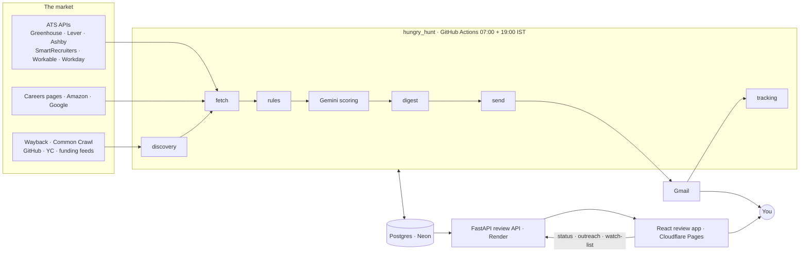
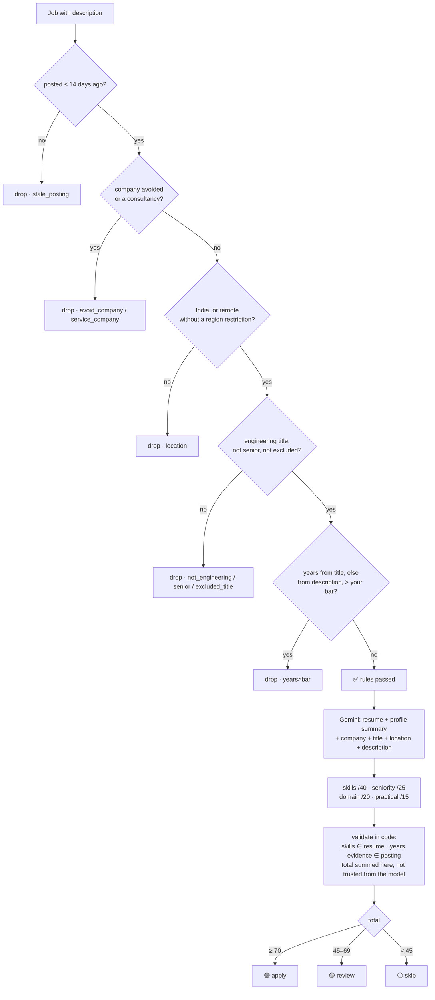
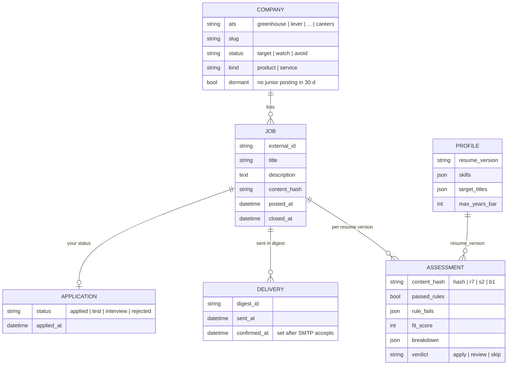

<div align="center">

# 🎯 Hungry Hunt

**A job-search agent that reads company hiring systems directly, drops what does not fit an early-career engineer, scores the rest against your resume, and emails one honest digest a day.**

[](https://github.com/Poojitha319/hungry_hunt/actions/workflows/ci.yml)
[](https://www.python.org/)
[](https://fastapi.tiangolo.com/)
[](https://neon.tech/)
[](https://react.dev/)
[](https://ai.google.dev/)
[](https://mypy-lang.org/)
[](LICENSE)

> *It finds and decides. You apply.*

</div>

---

## The problem

Job boards are built for recruiters. A fresher with no referrals gets aggregator listings that closed weeks ago,
"SDE I" postings that quietly require three years, and a hundred tabs a day to find the four roles that are real.

Every company that hires at scale runs an applicant tracking system, and most expose their live openings as JSON.
Hungry Hunt reads those sources directly. A job reaches your inbox only if it is **posted on the company's own
hiring system**, **still live**, **in India or genuinely remote**, and its **experience bar** is one you can meet.
It never applies or messages anyone on your behalf.

## What it does

| | |
|---|---|
| 🔭 **Discovery** | Seeds, Wayback Machine, Common Crawl, GitHub lists, the YC directory, funding feeds and a headless sniffer turn company names into ATS boards. ~9,100 companies watched. |
| 🧩 **Adapters** | Greenhouse, Lever, Ashby, SmartRecruiters, Workable, Workday, Amazon, Google and JSON-LD careers pages, each read through the system's own API. |
| 🚦 **Rules** | Location, title, seniority, service companies, posting age and the years bar are pure functions with a reason tag per drop and a table-driven test per rule. |
| 🧠 **Scoring** | Gemini scores survivors on a four-part rubric; every claimed skill is checked against the resume, every cited experience figure against the posting. |
| 📬 **Delivery** | One email a day, a delivery ledger so nothing repeats, and a footer that says what the pipeline could not see. |
| 📮 **Tracking** | Forward a hiring email and the tracker links it to the job and advances its status. |
| 🖥 **Review app** | FastAPI + React: digest, job detail with score breakdown, status, outreach drafts, watch-list, coverage. |

---

## Architecture



Three ideas hold it together:

1. **Every drop is a pure function with a reason.** `scoring/rules.py` has no I/O. A job that is not in your
   digest has a tag (`location`, `senior`, `years>bar`, `stale_posting`, …) stored on its assessment.
2. **Delivery is a ledger.** A job is "delivered" only after SMTP accepts the message. Anything else rolls into
   tomorrow.
3. **Re-evaluation is keyed, not scheduled.** An assessment is cached under
   `content_hash | rules version | scoring version | years bar`. Change any one and only the affected jobs are
   redone on the next run.

### How a job gets decided



Rules run on every job, every time their inputs change, with no model call. Gemini is spent only on jobs that
already passed, and its output is checked against the two documents it was given before anything is stored.

### Data model



### The layers

| Layer | Lives in | Responsibility |
|---|---|---|
| Discovery | `discovery/` | Turn the market into `(ats, slug)` boards; classify company kind and tier; record blind spots |
| Adapters | `adapters/` | One module per hiring system → `list[Posting]`; `registry.py` is the only entry point |
| Pipeline | `pipeline/` | Fetch with adaptive cadence (target / watch / dormant / dead), prune, the daily run with per-stage isolation |
| Scoring | `scoring/` | Rules first, Gemini second, validation of the model's claims in code |
| Delivery | `delivery/` | Rank, section, render, send, confirm; grounded outreach drafts |
| Tracking | `tracking/` | IMAP reader for forwarded hiring mail → application status |
| API | `api/` | FastAPI app factory, token auth, routers per resource |
| Core | `core/`, `db/` | SSRF-guarded HTTP client with per-host limits, Pydantic schemas, protocols for fakes, SQLAlchemy models and Alembic migrations |

The full mechanics (daily run, fetch cadence, assessment key, HTTP guard, module dependency graph) are in
[docs/ARCHITECTURE.md](docs/ARCHITECTURE.md). Setup, configuration and deployment are in
[docs/OPERATIONS.md](docs/OPERATIONS.md).

---

## Project structure

```
src/hungry_hunt/
├── cli/          parser.py · commands.py
├── core/         http.py · schemas.py · ports.py
├── db/           engine.py · models.py
├── adapters/     greenhouse · lever · ashby · smartrecruiters · workable · workday · amazon · google · careers · registry
├── discovery/    discover.py · seeds.py · funding.py · sitemaps.py · sniff.py
├── pipeline/     fetch.py · prune.py · run.py
├── scoring/      rules.py · gemini.py · assess.py · profile.py
├── delivery/     digest.py · send.py · outreach.py · templates/
├── tracking/     track.py
└── api/          app.py · deps.py · routes/
frontend/         Vite + React review app
migrations/       Alembic
tests/            mirrors src/ · fixtures captured from real APIs · no network
```

## Quick start

```bash
make install                 # uv sync --extra dev (pip fallback) + pre-commit hook
cp .env.example .env         # Gemini key, Gmail app password, review token
make migrate                 # SQLite locally, Postgres in production
hunt profile                 # extract your profile from resume.tex, once per resume
hunt discover --seeds && hunt fetch && hunt assess && hunt digest --preview digest.html
make check                   # ruff · ruff format · mypy · pytest (439 tests, ~7 s)
```

## Engineering notes

- **Tests never touch the network.** DNS is pinned by a fixture, HTTP is mocked, fixtures are real API responses.
- **Strict tooling.** Ruff with the security, bugbear and simplification rule sets, `ruff format`, mypy on
  `src/`, pre-commit, and a CI workflow that runs all of it plus the frontend checks on every push.
- **Hardened outbound HTTP.** Hosts are resolved and refused unless every address is public; redirects are followed
  by hand through the same check; bodies are size-capped; regexes are ReDoS-safe.
- **Own adapters, not a scraping library.** Each ATS has a stable public API. Reading it directly is more reliable
  than HTML scraping and lets discovery cover the whole market rather than a fixed list.
- **Keyed re-evaluation.** Bumping `RULES_VERSION` or `SCORING_VERSION` re-scores exactly the jobs it affects.
- **Blind spots are reported, never hidden.** The digest footer lists hiring systems it cannot read and boards that
  went stale.

## License

MIT. Built by [Sai Poojitha Sajjavarapu](https://github.com/Poojitha319).
