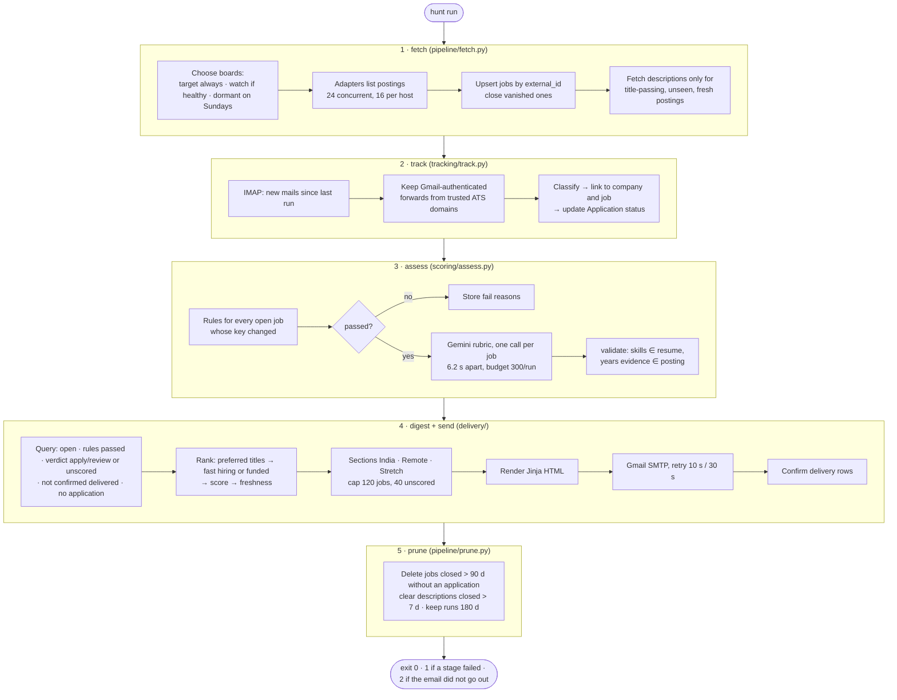
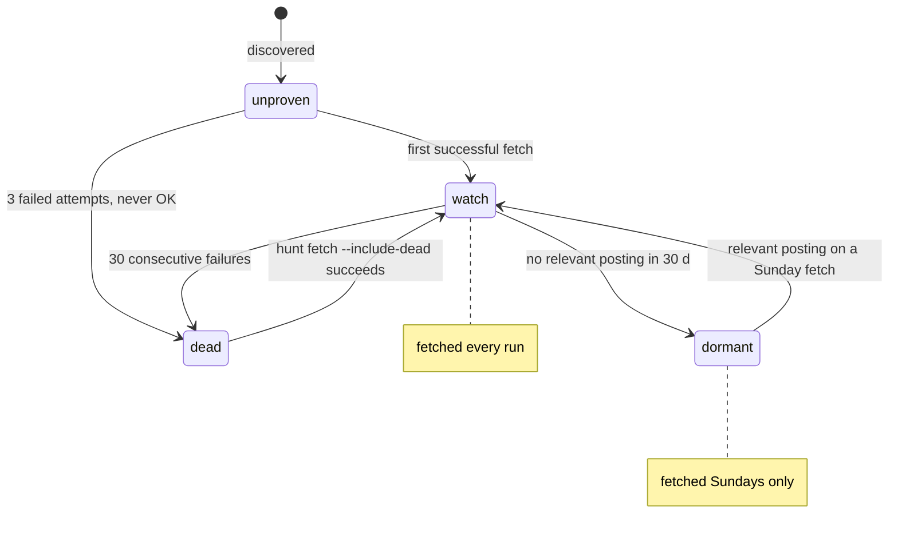
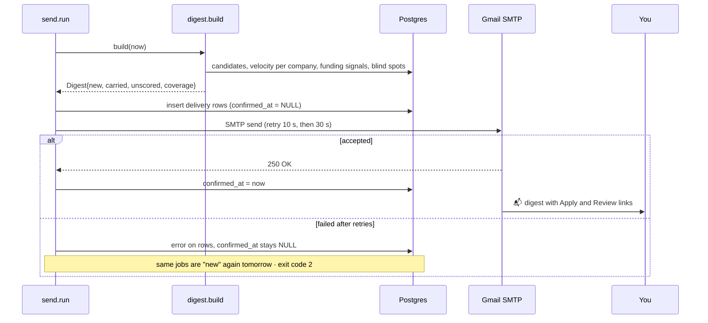
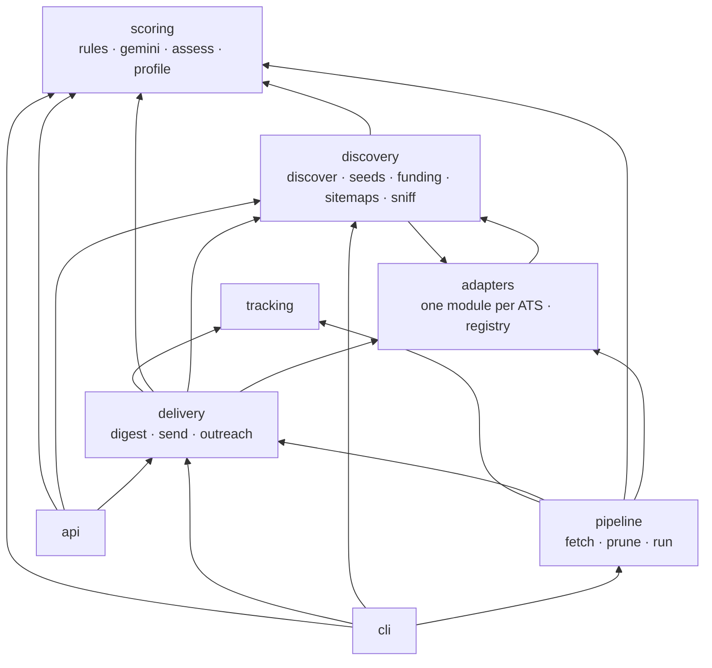

# Architecture

The README gives the shape. This file holds the mechanics a maintainer or reviewer needs: the daily run, each
layer in detail, the assessment key, the fetch cadence, the outbound HTTP guard, the delivery ledger and the
module dependency graph. Setup and deployment are in [OPERATIONS.md](OPERATIONS.md).

## One daily run



Each stage is isolated: a fetch failure does not stop assessment, an assessment failure does not stop the email.
`pipeline/run.py` holds the orchestration (`run_daily`) with one try/except per stage and a `RunSummary` whose
`exit_code` the CLI returns. Every stage writes a `run` row with its stats.

## The layers in detail

### Discovery (`discovery/`)

Turns the open market into `(ats, slug)` boards. Sources, selectable with `hunt discover --sources ...`:

| Source | What it reads | What it yields |
|---|---|---|
| `seeds` | `seeds.py`: 59 hand-verified boards | target boards that are always fetched |
| `wayback` | Wayback CDX index for the ATS hosts | every slug those hosts ever served |
| `cc` | Common Crawl index, five recent crawls | the same, for the long tail |
| `github` | curated "companies hiring in India" lists | names and board URLs |
| `yc` | the public YC directory | India-linked companies, probed at `/careers`, `/jobs`, `/` |
| `careers` | a company's own site | JSON-LD `JobPosting` pages, linked job pages, sitemap job URLs |
| `funding` | Inc42, YourStory, TechCrunch venture feeds | `funding_signal` rows, `funded_at` on matched companies |
| `sniff` | headless Chromium (optional `[sniff]` extra) | the ATS behind JavaScript-only careers pages |

Companies are classified on the way in: `kind` (product, service, unknown) from title and name heuristics, `tier`
(early_funded, mid, large) from team size and posting count. Unsupported systems are stored as blind spots and
listed in the digest footer.

### Adapters (`adapters/`)

One module per hiring system, three shapes:

- **Single JSON endpoint** (Greenhouse, Lever, Ashby): `HOSTS` with EU fallback, `PARAMS`, `parse(data)`.
- **Paged** (SmartRecruiters, Workable feed, Workday CXS, Amazon, Google): `async board(client, slug, limits)`.
- **Careers page** (`careers.py`): JSON-LD blocks, then linked job pages, then the sitemap; `html.py` extracts a
  posting from an `<h1>` plus hiring cues when there is no structured data.

`registry.py` is the only thing the pipeline imports: `SUPPORTED`, `board_url()`, `list_jobs()` and `AtsSource`,
which also fetches per-job descriptions where a second call is needed (Greenhouse, SmartRecruiters, Workday).
Adding a system: one module, one registry entry, one fixture, one test (see `CONTRIBUTING.md`).

### Pipeline (`pipeline/`)

`fetch.py` chooses boards by health and cadence, lists them concurrently, upserts jobs, closes vanished ones, and
fetches descriptions only for title-passing, unseen, fresh postings.



| Board state | Condition | Fetched |
|---|---|---|
| target | `company.status == "target"` | every run |
| healthy watch | `last_ok` set, `fail_count < 30`, not dormant | every run |
| unproven | never succeeded, `fail_count < 3` | every run until it succeeds or hits 3 |
| dormant | no title-passing posting in 30 days | Sundays only |
| dead | `fail_count >= 30` | only with `--include-dead` |

Descriptions are cached for seven days and skipped for postings older than the age cap, which brought a full
market fetch from 30 minutes to about 11. Workable is read through its India feed, grouped into `workable:<id>`
member rows that are never polled directly (direct polling is rate-banned).

### Scoring (`scoring/`)

**Rules** (`rules.py`, `RULES_VERSION = 7`) are pure functions: `location()` classifies India / remote /
restricted from the raw string and description; `title_kind()` says engineering-or-not and senior-or-not;
`years_in_title()` then `years_bar()` read the experience bar; `company_kind()` flags consultancies; `evaluate()`
combines them into a `RuleResult` with tags.

**Gemini** (`gemini.py`, `assess.py`, `SCORING_VERSION = 2`) sees the resume text, a profile summary, company,
title, location and description, and must return strict JSON: matched and missing skills, min/max years with a
verbatim `years_evidence` quote, and a four-part `Breakdown`. `validate()` removes any matched skill not in the
resume, drops years evidence not found in the posting, sums the total in code and sets the verdict at 70 / 45.
Calls are spaced 6.2 s apart with a per-run budget; a quota error ends the stage cleanly with `quota_hit` in the
footer.

`profile.py` builds the profile once per resume version (sha1 of the LaTeX text).

### Delivery (`delivery/`)

`digest.py` queries candidates, ranks them (preferred titles → fast-hiring or recently funded companies → score →
freshness), splits new from carried, applies caps and builds the coverage footer. `send.py` writes delivery rows,
sends over Gmail SMTP with two retries, and confirms the rows only on success. `outreach.py` drafts a LinkedIn or
email message and validates that every proper noun, number and skill traces back to the resume or the posting.



### Tracking (`tracking/track.py`)

Reads new mail over IMAP (headers plus the first 2 KB), keeps only Gmail-authenticated forwards from trusted ATS
and company domains, classifies the event (applied, test, interview, rejected) from subject and snippet, matches
company by name and job by title, and writes an `application` row. Status moves forward only.

### API (`api/`) and frontend (`frontend/`)

`create_app(settings, sf, now, llm)` is an injectable factory; tests run it in-process with SQLite and fakes.
Routes: `/health`, `/api/digest`, `/api/jobs/{id}`, `/api/jobs/{id}/status`, `/api/jobs/{id}/outreach`,
`/api/companies`, `/api/companies/{id}`, `/api/coverage`, all behind one bearer token compared in constant time.
The frontend's client is generated from the app's OpenAPI schema; CI fails if it drifts.

### Core (`core/`, `db/`, `log.py`, `config.py`)

`core/http.py` is the only way to the internet (see below). `core/schemas.py` holds the Pydantic models between
stages; `core/ports.py` the `JobSource`, `Assessor` and `Mailer` protocols that fakes implement. `db/engine.py`
pre-pings and recycles pooled Postgres connections every five minutes; `TZDateTime` keeps datetimes UTC-aware on
both backends. `log.py` configures one root handler, plain text or JSON lines.

## The assessment key

Every `assessment` row stores a key built in `scoring/assess.py`:

```
{job.content_hash} | r{RULES_VERSION} | s{SCORING_VERSION} | b{profile.max_years_bar}
```

- `content_hash` is sha1 of title, location and description, so an edited posting is re-assessed.
- `RULES_VERSION` changes whenever a drop rule changes meaning; `SCORING_VERSION` whenever the rubric does.
- `max_years_bar` is part of the key so lowering the bar re-evaluates years rules without touching anything else.

A job is re-evaluated when its stored key differs from the current one. Scores from a previous scoring version are
kept until the new version's call succeeds, so a quota hit never leaves a previously scored job unscored.
Assessments are per `resume_version`, so a new resume starts a fresh set.

## Outbound HTTP guard

Everything leaves through `core/http.py`:

1. `safe_url()` refuses non-http(s) schemes, `localhost`, `.local` and `.internal`, resolves the hostname and
   requires **every** returned address to be global.
2. Requests use `follow_redirects=False`; at most three redirects are followed by hand, each through `safe_url()`.
3. Bodies are capped (400 KB for HTML, 1 MB per JSON-LD block) before parsing.
4. `Limits` holds one global semaphore (`FETCH_CONCURRENCY`) and one per host (`FETCH_PER_HOST`).
5. Retries use a short fixed backoff on transport errors only; HTTP errors become `BoardError` with the status.

Known gap: the host is resolved before the connection, so a DNS answer that changes between check and connect
could reach a private address. Pinning the checked address into the transport is the planned fix.

## Delivery ledger

`send.py` inserts one `delivery` row per job with `confirmed_at = NULL`, sends, and on SMTP acceptance sets
`confirmed_at`. `digest.build` excludes jobs with a confirmed delivery and marks jobs with an unconfirmed one as
*carried*. A job also leaves the digest the moment an `application` row exists for it.

## Module dependencies

Arrows are package-level imports, generated from the source (`config`, `core`, `db` and `log` are omitted as
targets because almost everything imports them). The rule: `pipeline` is the top of the stage stack and nothing
below it imports it; `api` and `cli` are the only entry points; `adapters` never touch the database; `tracking`
and `scoring` never import another stage. `tests/test_hygiene.py` pins the `pipeline` rule.



`adapters.careers` imports `discovery.sitemaps` for its sitemap fallback and `discovery.discover` imports the
adapters' HTML readers to probe careers pages; the two packages are peers. `delivery` reads `tracking`
(application rows decide what leaves the digest) and `discovery.funding` (the funded badge), which is why it sits
above both.

## Where the time goes

Measured on the full market from a laptop (Neon in us-east-2):

| Stage | Typical | Notes |
|---|---|---|
| fetch | 11 min | ~220 active boards daily, ~7,000 on Sundays; description calls dominate |
| track | seconds | IMAP header fetch |
| assess | 6 min | 6.2 s per Gemini call, budget 300 |
| digest + send | seconds | |
| prune | seconds | |

GitHub Actions has a 90-minute job timeout; the Sunday discovery job has 120.
