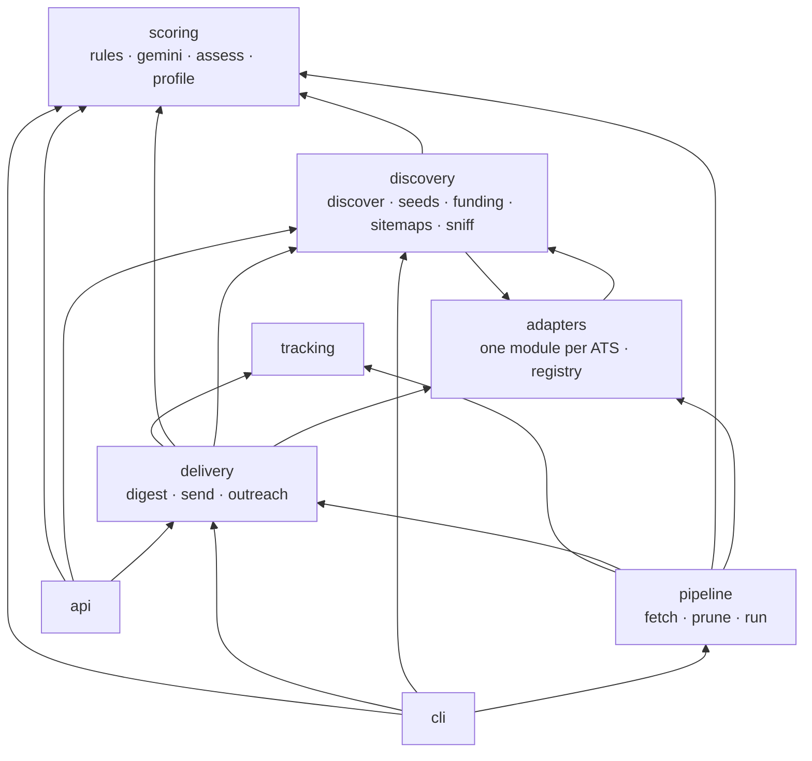

# Architecture notes

The README explains each layer for a reader. This file records the mechanics a maintainer needs: module
dependencies, the assessment key, the fetch cadence, and the outbound HTTP guard.

## Module dependencies

Arrows are package-level imports, generated from the source (`config`, `core`, `db` and `log` are omitted as
targets because almost everything imports them). The rule: `pipeline` is the top of the stage stack and nothing
below it imports it; `api` and `cli` are the only entry points; `adapters` never touch the database; `tracking`
and `scoring` never import another stage. A test in `tests/test_hygiene.py` pins the `pipeline` rule.



Two edges deserve a note. `adapters.careers` imports `discovery.sitemaps` for its sitemap fallback, and
`discovery.discover` imports the adapters' HTML readers to probe careers pages; the two packages are peers. The
`delivery` package reads `tracking` (application rows decide what leaves the digest) and `discovery.funding` (the
funded badge), which is why `delivery` sits above both.

## The assessment key

Every `assessment` row stores a key built in `scoring/assess.py`:

```
{job.content_hash} | r{RULES_VERSION} | s{SCORING_VERSION} | b{profile.max_years_bar}
```

- `content_hash` is sha1 of title, location and description, so an edited posting is re-assessed.
- `RULES_VERSION` (`scoring/rules.py`) changes whenever a drop rule changes meaning.
- `SCORING_VERSION` (`scoring/assess.py`) changes whenever the rubric or prompt changes.
- `max_years_bar` is part of the key so lowering the bar from 2 to 1 re-evaluates years rules and model-derived
  years without touching anything else.

`run_rules` re-evaluates a job when its stored key differs from the current one. Scores from a previous scoring
version are kept until the new version's call succeeds, so a quota hit never leaves a job unscored that was scored
before. Assessments are per `resume_version`, so a new resume starts a fresh set.

## Fetch cadence

`pipeline/fetch.py` decides which boards to list on each run:

| Board state | Condition | Fetched |
|---|---|---|
| target | `company.status == "target"` | every run |
| healthy watch | `last_ok` set, `fail_count < 30`, not dormant | every run |
| unproven | never succeeded, `fail_count < 3` | every run until it succeeds or hits 3 |
| dormant | no title-passing posting in 30 days | Sundays only (`now.weekday() == 6`) |
| dead | `fail_count >= 30` | only with `--include-dead` |

Descriptions are fetched only for postings that pass the title prefilter, are not already known with a fresh
description (`DESCRIPTION_TTL` = 7 days) and are not older than the posting-age cap. This is what brought a full
market fetch from 30 minutes to about 11.

Workable is read through the India feed (`workable_feed:India`), which groups postings into `workable:<company id>`
member rows that are never polled directly (direct polling of apply.workable.com is rate-banned for a day on the
first burst).

## Outbound HTTP guard

Everything leaves through `core/http.py`:

1. `safe_url()` parses the URL, refuses non-http(s) schemes, `localhost`, `.local` and `.internal` hosts, resolves the
   hostname and requires **every** returned address to be global (no loopback, private, link-local, multicast or
   reserved ranges).
2. Requests are made with `follow_redirects=False`; the code follows at most three redirects by hand, running
   `safe_url()` on each hop.
3. Bodies are capped (`MAX_PAGE` 400 KB for HTML, `MAX_LDJSON` 1 MB per JSON-LD block) before parsing.
4. `Limits` holds one global semaphore (`FETCH_CONCURRENCY`) and one per host (`FETCH_PER_HOST`).
5. Retries use a short fixed backoff (2 s, 8 s) on transport errors only; HTTP errors become `BoardError` with the
   status so the fetch stage can count a board as failed without retrying a 404.

Known gap: the host is resolved before the connection, so a DNS answer that changes between the check and the
connect could reach a private address. Pinning the checked address into the transport is the planned fix.

## Delivery ledger

`delivery/send.py` inserts one `delivery` row per job in the digest with `confirmed_at = NULL`, sends, and on a
2xx from SMTP sets `confirmed_at`. `digest.build` excludes jobs with a confirmed delivery and marks jobs with an
unconfirmed one as *carried*. A job also leaves the digest the moment an `application` row exists for it, whatever
the status, because you have already decided.

## Where the time goes in a run

Measured on the full market from a laptop (Neon in us-east-2):

| Stage | Typical | Notes |
|---|---|---|
| fetch | 11 min | ~220 active boards daily, ~7,000 on Sundays; description calls dominate |
| track | seconds | IMAP header fetch |
| assess | 6 min | 6.2 s per Gemini call, budget 300 |
| digest + send | seconds | |
| prune | seconds | |

GitHub Actions has a 90-minute job timeout; the Sunday discovery job has 120.
