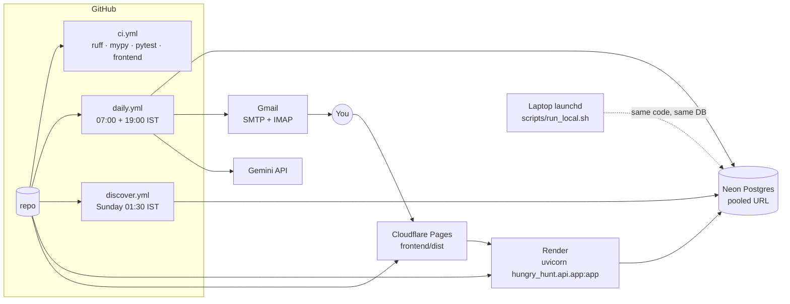

# Operations

Setup, configuration, running, deploying, and what the agent can and cannot read.

## Setup

Requirements: Python 3.12, Node 22 for the review app, optionally [uv](https://docs.astral.sh/uv/).

```bash
git clone https://github.com/Poojitha319/hungry_hunt && cd hungry_hunt
make install                     # uv sync --extra dev, or a pip venv if uv is absent; installs the pre-commit hook
cp .env.example .env             # fill GEMINI_API_KEY, SMTP_USER, SMTP_PASSWORD, DIGEST_TO, REVIEW_TOKEN
make migrate                     # creates hunt.db (SQLite) at migration head
```

Without uv: `python3.12 -m venv .venv && . .venv/bin/activate && pip install -e ".[dev]"`.

Put your resume as LaTeX at the path in `RESUME_TEX` (default `./resume.tex`). The profile is extracted locally,
never in CI, and the resume text leaves your database only inside Gemini scoring calls.

## Configuration

Every setting is an environment variable or a line in `.env` (`src/hungry_hunt/config.py`).

| Variable | Default | Meaning |
|---|---|---|
| `DATABASE_URL` | `sqlite:///hunt.db` | SQLAlchemy URL; `postgresql://` is upgraded to the psycopg driver |
| `USER_ID` | `poojitha` | key for your rows; one database can hold several users |
| `GEMINI_API_KEY` | | Google AI Studio key |
| `GEMINI_MODEL` | `gemini-3.5-flash-lite` | any model with a usable free quota |
| `ASSESS_MAX_CALLS` | `300` | Gemini calls per run |
| `ASSESS_INTERVAL_S` | `6.2` | seconds between calls (free-tier rate) |
| `SMTP_USER`, `SMTP_PASSWORD` | | Gmail address and app password; also used for IMAP tracking |
| `DIGEST_TO` | | where the digest goes |
| `REVIEW_BASE_URL` | `http://localhost:5173` | the review app origin (CORS and email links) |
| `REVIEW_TOKEN` | | shared bearer token for the API |
| `DIGEST_MAX_JOBS` | `120` | cap per email |
| `FETCH_CONCURRENCY`, `FETCH_PER_HOST` | `24`, `16` | outbound limits |
| `REMOTE_OK` | `true` | include unrestricted remote roles |
| `MAX_YEARS_BAR` | `2` | drop postings whose minimum experience exceeds this |
| `MAX_POSTED_AGE_DAYS` | `14` | drop postings older than this |
| `RESUME_TEX` | `./resume.tex` | your resume source |
| `TRACK_DAYS`, `TRACK_REQUIRE_FORWARDED` | `14`, `true` | tracker lookback; require Gmail forward headers |
| `LOG_LEVEL`, `LOG_FORMAT` | `INFO`, `plain` | `json` for log collectors |

Note: an empty environment value does not override `.env` (`env_ignore_empty`). To run without mail credentials
on a machine that has a `.env`, point `--env-file` or `ENV_FILE` at a different file rather than exporting blanks.

## Running

```bash
hunt profile --targets "backend,python,SDE,AI engineer,LLM" --exclude "Android,iOS"   # once per resume change
hunt discover --seeds                                   # the verified boards
hunt discover --slugs data/slugs.json                   # optional: 8.7k harvested boards
hunt discover --sources funding,wayback,cc,github,yc,careers   # the weekly discovery (minutes to an hour)
hunt fetch --only lever:hevodata,greenhouse:observeai   # or just `hunt fetch`
hunt assess --max-calls 20
hunt digest --preview digest.html && open digest.html   # look before you send
hunt send                                               # or the whole thing: hunt run
```

Exit codes from `hunt run`: 0 clean, 1 a stage failed but the email went out, 2 the email did not go out.

Review app:

```bash
make api                                   # http://localhost:8000, docs at /docs
cd frontend && npm ci && npm run gen && VITE_API_URL=http://localhost:8000 npm run dev
```

Docker (API image; meant for Postgres, since a SQLite file inside the container vanishes with it):

```bash
make docker && docker run --rm -p 8000:8000 --env-file .env hungry-hunt
docker run --rm --env-file .env hungry-hunt hunt run      # the pipeline in the same image
```

## Deploying



1. **Database.** Create a Neon project and copy the pooled connection string into `DATABASE_URL`. Run
   `alembic upgrade head` once from your machine, then
   `python -m hungry_hunt.db.copydb sqlite:///hunt.db "$DATABASE_URL"` if you have local history to keep.
2. **GitHub Actions.** Secrets: `DATABASE_URL`, `GEMINI_API_KEY`, `SMTP_USER`, `SMTP_PASSWORD`, `DIGEST_TO`,
   `REVIEW_TOKEN`. Variables: `GEMINI_MODEL`, `USER_ID`, `REVIEW_BASE_URL`. Enable `daily` and `discover`,
   trigger `daily` once by hand and check the run log and the digest artifact. GitHub pauses scheduled workflows
   on public repositories after 60 days without a commit; a separate `keepalive` job in `daily.yml` re-enables
   the schedule through the API so the digest keeps coming.
3. **API on Render.** `render.yaml` is a blueprint: connect the repo, set the same secrets, health check `/health`.
4. **Review app on Cloudflare Pages.** Root directory `frontend`, build `npm ci && npm run build`, output `dist`,
   environment `VITE_API_URL` = the Render URL. Set `REVIEW_BASE_URL` to the Pages URL so email links and CORS
   match.
5. **Laptop fallback.** Copy `scripts/com.hungryhunt.daily.plist.example` to `~/Library/LaunchAgents/`, fix the
   paths, `launchctl bootstrap gui/$UID <plist>`. It runs the same `hunt run` against the same database; turn it
   off once Actions is green.

Secrets live in GitHub Actions secrets, Render environment variables and your local `.env`. Nothing in the
repository or its history contains a credential; `SECURITY.md` has the details.

## Hiring systems

| System | Slug form | Discovered by | Listing | Description | Status |
|---|---|---|---|---|---|
| Greenhouse | `greenhouse:<board>` | wayback, cc, github, sniff | boards API (US, EU fallback) | per-job call, cached 7 d | ✅ |
| Lever | `lever:<company>` | wayback, cc, github, sniff | postings API | in listing | ✅ |
| Ashby | `ashby:<company>` | wayback, cc, sniff | job-board API | in listing | ✅ |
| SmartRecruiters | `smartrecruiters:<company>` | sniff, add by URL | public postings API, paged | per-job call | ✅ |
| Workable | `workable_feed:India` → `workable:<id>` members | feed | jobs.workable.com India feed | in listing | ✅ feed only; direct polling is rate-banned |
| Workday | `workday:<host>/<tenant>/<site>` | sniff, add by URL | CXS jobs API, paged | per-job call | ✅ |
| Amazon | `amazon:IND` | seed | search JSON | in listing | ✅ |
| Google | `google:India` | seed | results page data records | in listing | ✅ |
| Careers page | `careers:<url>` | yc, careers, sniff | JSON-LD → linked pages → sitemap → HTML | in page | ✅ when server-rendered |
| Eightfold, Phenom, Oracle HCM, Darwinbox, Keka | — | recognised, stored as blind spots | — | — | ❌ listed in the footer |

Pages that render only in JavaScript are found by the weekly sniffer, which usually reveals an ATS behind them
(PhonePe and Swiggy turned out to be SmartRecruiters). What stays blind is reported, never silently skipped.

## Testing and quality

```bash
make check            # ruff check · ruff format --check · mypy · pytest (no network)
cd frontend && npm run lint && npm run typecheck && npm test && npm run build
pre-commit run --all-files
```

Tests mirror the package. Fixtures in `tests/fixtures/` are real API responses. The autouse `public_dns` fixture
pins DNS so the SSRF guard passes without resolving anything, and `respx` mocks HTTP. To run against Postgres:
`HUNT_TEST_DATABASE_URL=postgresql://... pytest`. CI (`.github/workflows/ci.yml`) runs the Python and frontend
checks on every push and pull request with a frozen lockfile, and fails if `frontend/openapi.json` drifts from the
app.

## Known limitations

- JavaScript-only careers pages without an ATS behind them are still blind.
- Eightfold, Phenom, Oracle HCM, Darwinbox and Keka have no adapter yet; they are reported, not read.
- The Gemini free tier limits scoring to a few hundred jobs a day; unscored survivors are listed separately.
- Tracking depends on forwarding hiring mail to the digest mailbox, and classification is pattern-based.
- Security notes on the DNS-rebinding window, the token in the review link and forwarded-mail trust are in
  [SECURITY.md](../SECURITY.md).

## Roadmap

- Pin the resolved address into the HTTP transport (closes the rebinding window).
- Session cookie for the review app instead of a token in the link.
- Adapters for Darwinbox and Keka; a generic JSON-recipe adapter for one-off careers APIs.
- WhatsApp delivery alongside email.
- A weekly summary of where responses come from, which rules drop the most, and what to change.
